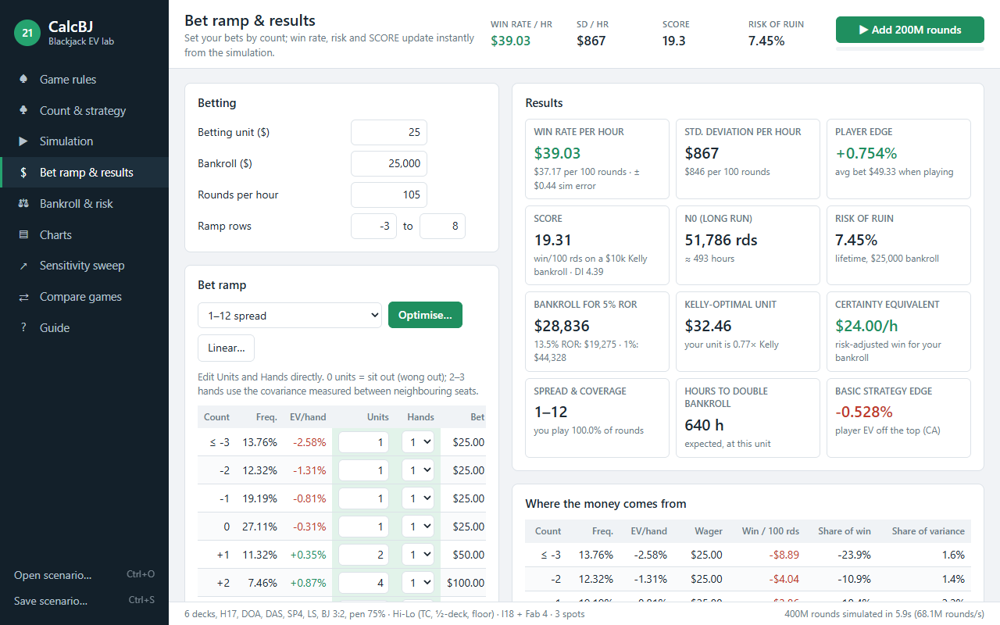
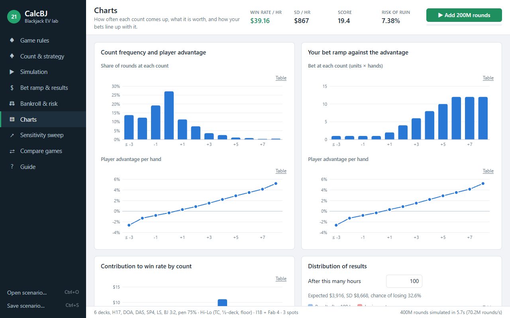

# CalcBJ

**A blackjack advantage calculator for card counters.** Enter the game's rules, pick your count, index plays and bet
ramp, and CalcBJ tells you what the game is worth: your win rate per hour, its standard deviation, SCORE, N0, your risk
of ruin, the bankroll you need, and the best ramp for your spread. It runs on Windows, Mac, Linux and Android, needs no
internet connection, and works everything out on your own device.

## Download

Get the latest version from the [Releases page](https://github.com/xXBenZeXx/CalcBJ/releases/latest), under
**Assets**. It is free and needs no account.

| System | File | How to install |
|---|---|---|
| **Windows** 10 or 11 | `CalcBJ_<version>_x64-setup.exe` | Run it. It installs for your user account, without administrator rights. If Windows says it protected your PC, click **More info → Run anyway**. |
| **Mac**, macOS 12 or later (Apple silicon and Intel) | `CalcBJ_<version>_universal.dmg` | Open it and drag CalcBJ into Applications. The first time, macOS won't open it: go to **System Settings → Privacy & Security**, scroll down and click **Open Anyway**. |
| **Linux**, 64-bit Intel or AMD (Ubuntu 22.04, Debian 12 or newer) | `CalcBJ_<version>_amd64.AppImage` | Runs without installing: `chmod +x CalcBJ_*.AppImage`, then start it. |
| | `CalcBJ_<version>_amd64.deb` | Debian, Ubuntu, Mint: `sudo apt install ./CalcBJ_*_amd64.deb` |
| | `CalcBJ-<version>-1.x86_64.rpm` | Fedora, openSUSE: `sudo dnf install ./CalcBJ-*.x86_64.rpm` |
| **Android** 7 or later, 64-bit (practically every phone of the last years) | `CalcBJ_<version>_android-arm64.apk` | Download it on the phone and open it. When Android asks, allow your browser to install apps, go back and tap **Install**. If Play Protect warns about an unknown app, choose **More details → Install anyway**. |

The warnings appear because CalcBJ is not signed with a paid Microsoft or Apple certificate and doesn't come from an
app store; they don't mean anything is wrong with it.

**Updating:** install the new version over the old one. Your settings, results and comparisons stay. (On Android,
uninstalling the app deletes its data, so save a scenario first if you ever do.)

## Getting started

1. **Game rules:** number of decks, penetration, soft 17, surrender, doubling and splitting rules, number of spots. The
   house edge for basic strategy updates as you type, along with what every single rule is worth.
2. **Count & strategy:** one of 13 counts or your own tags, and the index plays you use: basic strategy, the
   Illustrious 18, I18 + Fab 4, or a full set of indices generated for your count and rules. A colour chart shows the
   strategy at any count.
3. **Simulation:** press **Run simulation** (F5; Esc stops). CalcBJ deals real shoes on every processor core, tens of
   millions of rounds a second on a modern PC, and records your results at every count. It only simulates when you
   press Run.
4. **Bet ramp & results:** set your bet at each count (0 to sit out). Win rate, standard deviation, SCORE, N0 and risk
   of ruin update at once, without simulating again. The optimiser finds the best ramp for your spread, or a Kelly ramp
   for your bankroll.
5. **Bankroll & risk, Charts, Sensitivity sweep, Compare games:** the risk of a losing trip and the bankroll you need,
   charts of your edge and your bets by count, how the results change with penetration, decks or spots, and games side
   by side.

**Save scenario** (Ctrl+S) keeps everything, results included, in a `.bjev` file that opens in CalcBJ on any of your
devices (**Open scenario**, Ctrl+O). The **Guide** page in the app explains the rest.

## What's inside

| Page | |
|---|---|
| Game rules | Decks, penetration, H17/S17, peek/ENHC/OBO, blackjack payout, doubling, DAS, splits, RSA/HSA, surrender, spots, rounds per hour. The basic-strategy house edge and the effect of every single rule change, worked out exactly. |
| Count & strategy | 13 counts (Hi-Lo, KO, Hi-Opt I/II, Omega II, Zen, Wong Halves, Uston APC/SS, RPC, Canfield Expert, Silver Fox, Red Seven) or your own tags, including separate tags for red cards. True count (deck estimation, floor/truncate/round) or running count. Index plays: basic strategy, Illustrious 18, I18 + Fab 4 or a full set, **generated for your exact count and rules**, plus your own overrides. |
| Simulation | A shoe simulator on every processor core that keeps the expectation, variance and covariance of two seats for every count. Results are kept for each set of settings, so returning to settings you already simulated is instant, and Run adds rounds to them. |
| Bet ramp & results | Units and hands at each count (0 = wong out). Win rate, standard deviation, edge, SCORE, DI, N0, risk of ruin, the bankroll for 5%, 13.5% and 1% risk, the Kelly unit and certainty equivalent. Presets, linear ramps and an optimiser (best SCORE within a spread, or Kelly for your bankroll, with wonging and several hands if you like). |
| Bankroll & risk | Lifetime and trip risk of ruin, the chance of a losing trip, percentile outcomes, risk-of-ruin curve, result bands over time. |
| Charts | How often each count comes up and the advantage there, your bets against the advantage, where the win comes from, the distribution of results. |
| Sensitivity sweep | The same game across penetration, decks, spots or index sets, or the best SCORE for each maximum bet. |
| Compare games | Snapshots of different scenarios side by side, with the best value highlighted. |

## How accurate is it?

* **Exact where it can be.** Basic strategy and the house edge come from an exact calculation with card removal, not
  from a simulation, and match published figures: 0.41% for 6 decks S17 DAS, 0.62% with H17.
* **Indices made for your count.** Index plays are generated for your exact count, rules and rounding. For Hi-Lo with
  6 decks, the Illustrious 18 and Fab 4 come out within one point of the published numbers.
* **A realistic simulator.** Every decision uses the count at that moment, every spot is played, and billions of test
  rounds agree with the exact calculation.
* **Checked on every change.** Automated tests compare the house edges with published figures, check that no single
  change of any basic strategy decision does better, and compare simulations with the exact calculation.

The details are in [How CalcBJ works](docs/how-it-works.md).

## Privacy

CalcBJ needs no account and no internet connection, and it sends nothing anywhere. Your settings, results and
comparisons stay on your device; scenario files go only where you save them.

## Troubleshooting

**Windows says it protected your PC, or macOS says CalcBJ can't be opened.** CalcBJ isn't signed with a paid
certificate. The one-time steps that let it run are in [Download](#download).

**Linux: the AppImage doesn't start and mentions FUSE.** Install FUSE 2 (`sudo apt install libfuse2`, on Ubuntu 24.04
and later `libfuse2t64`), or start it with `APPIMAGE_EXTRACT_AND_RUN=1 ./CalcBJ_<version>_amd64.AppImage`. That way it
also runs in WSL on Windows 11.

**Results say "simulated with an older version of CalcBJ".** A newer version works simulations out a little
differently. Press Run (F5) to simulate those settings again; CalcBJ never adds new rounds to an older version's
results.

**Android says "App not installed" when updating.** Updates install only over a CalcBJ from these releases, which are
all signed with the same key. If yours came from somewhere else, save your scenarios, uninstall it and install the new
one.

**Android from 2027.** Google plans to require registered developers for apps installed from outside Google Play.
Installing CalcBJ may then need a few extra steps; see [Google's developer verification](docs/development.md#googles-developer-verification-from-2027).

## For developers

The engine is written in Rust and runs as WebAssembly; the interface is TypeScript and Svelte, and Tauri turns them
into the desktop and Android apps. Building, testing and releasing are in [docs/development.md](docs/development.md),
the engine in [web/engine](web/engine/README.md), the app in [web/app](web/app/README.md) and the maths in
[docs/how-it-works.md](docs/how-it-works.md).
